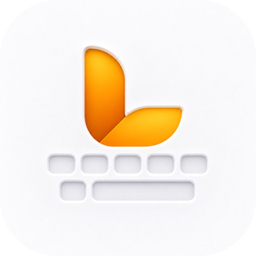
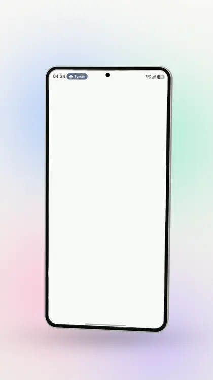
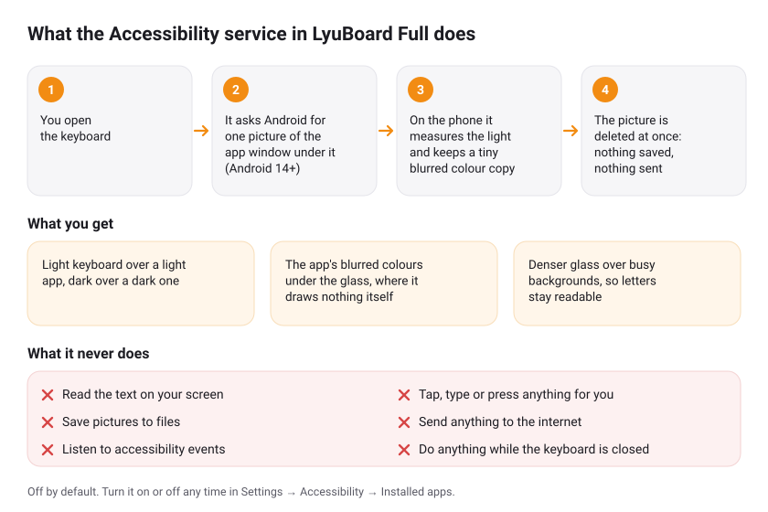

  

<h1 align="center">LyuBoard</h1>

  <b>An Android keyboard with a frosted glass look, mechanical keycaps and smart autocorrect.</b> 
  Open beta before Google Play: try it and tell us what you think.

  
  
  
  

  <b>English</b> · <a href="README.ru.md">Русский</a>

  

## Why this page exists

LyuBoard is heading to Google Play. Before that, I want real people with real phones to use it for a while and say
what is great, what is annoying and what is broken. That is this beta.

**What I'd love to hear:** bugs and crashes, lag on your phone, autocorrect that fixes the wrong thing, words it doesn't
know, things that look off in your apps, and features you miss from your current keyboard.
Leave it in [Issues](https://github.com/lyutobor/LyuBoard/issues/new/choose), [Discussions](https://github.com/lyutobor/LyuBoard/discussions) or the
[Telegram channel](https://t.me/lyuBoard).

## What's inside

- **Typing that keeps up.** Swipe typing, autocorrect that understands everyday typos, next-word suggestions that work offline,
  and keys that quietly adapt to where *your* finger actually lands.
- **41 keyboard languages**, from English, Russian and Ukrainian to Arabic, Hindi and Korean. The app itself speaks 17.
- **Looks you can feel.** Frosted glass and sea glass over any app, mechanical keycaps with backlight, real materials
  (aluminium, paper, ceramic, carbon, leather, stone), ready-made themes, swipe trails, key sounds and haptics to match.
- **✨ AI when you want it.** Rewrite, fix, make polite or shorter, answer a copied message, or just say what you need.
  Works with a free LyuBoard AI quota, your own key, or models that run on the phone.
- **The small things.** Clipboard history, an emoji row that guesses the right emoji, emoji mixing, GIFs, a Google translator that works offline (after a one-time language download),
  voice input, home-screen widgets with your typing stats, and a year-in-review of your typing.

## Download: Lite or Full?

There are **two APKs** in every [release](https://github.com/lyutobor/LyuBoard/releases/latest). They are the same keyboard; the only difference is
one Android Accessibility service.

| | **LyuBoard Lite** | **LyuBoard Full** |
|---|---|---|
| Everything listed above | ✅ | ✅ |
| Keyboard turns light or dark to match the app under it | — | ✅ |
| Blurred colours of the screen under the glass, where an app draws nothing | — | ✅ |
| Denser glass over busy backgrounds, so letters stay readable | — | ✅ |
| Installing | ✅ Play Protect warns, but offers "Install anyway" | ⚠️ You need to turn Play Protect off for a moment |
| **Pick it if** | you just want to try the keyboard | you want the glass to look its best (Android 14+) |

**Not sure? Take Lite.** You can install Full over it later: settings and learned words stay.

### Why are there two?

To see what is under the keyboard, LyuBoard Full uses Android's **Accessibility** permission. Google Play Protect treats
*any* app from outside Google Play that asks for Accessibility as dangerous, because malware abuses it. It simply refuses to
install such an APK: there is no "Install anyway" button at all, and Full installs only with Play Protect turned off
in the Play Store (see below). Lite doesn't contain that service, so Play Protect only warns and offers "Install anyway". Once LyuBoard is in Google Play, this split goes away.

### What exactly the Accessibility service does

  

## How to install

1. Download `LyuBoard-Lite-….apk` (or Full) from the [latest release](https://github.com/lyutobor/LyuBoard/releases/latest) on your phone.
2. Open it. Allow your browser or file manager to install unknown apps if Android asks.
   If Play Protect warns about Lite, tap **More details → Install anyway**.
3. Open **LyuBoard** and follow the welcome screen: it turns the keyboard on and picks it.

**To install Full.** Play Protect often doesn't say it's involved: you just see "App not installed" or "package
appears to be invalid". The file is fine. Open the **Play Store → your profile → Play Protect → ⚙ → turn off
"Scan apps with Play Protect"**, install the APK, then turn scanning back on. On Android 13+ the Accessibility switch may
be greyed out at first: open **Settings → Apps → LyuBoard → ⋮ → Allow restricted settings**, then turn it on.
Only do this if you're comfortable with it; Lite needs none of this.

## Good to know

- **This is a beta.** Each build stops working **45 days** after it was built and asks you to update. That way every tester
  has a fresh build with the fixes, not an old one with bugs that are already fixed. Click **Watch → Custom → Releases** at the top of this page to hear about new builds.
- **Android 12 or newer.** Tested most on Samsung Galaxy (One UI) and OnePlus.
- **Big download (~375 MB):** dictionaries for all 41 languages are inside, so typing works fully offline.
- **Updates install over each other.** All beta builds are signed with the same key. The Google Play version will be
  signed differently, so you'll reinstall once when it comes out.

## Privacy

- What you type stays on your phone. Learned words, clipboard history and statistics are stored on the device.
- **Crash reports** (Firebase Crashlytics) are on by default and never include your text. Turn them off in
  *About → Send crash reports*.
- Text goes to an AI service **only when you press ✨**, and only to the service you picked. The free LyuBoard AI
  receives the role name and up to 600 characters, and stores no text.
- GIF search talks to KLIPY directly from your phone.
- "Share anonymously" (word statistics to improve dictionaries) is optional and sends no sentences.

## Feedback

- 🐞 [Report a bug](https://github.com/lyutobor/LyuBoard/issues/new?template=bug.yml)
- 💡 [Suggest an idea](https://github.com/lyutobor/LyuBoard/issues/new?template=idea.yml)
- 💬 [Just tell me what you think](https://github.com/lyutobor/LyuBoard/discussions)
- ✈️ Telegram channel: [t.me/lyuBoard](https://t.me/lyuBoard)

Inside the app, **About → Send report** builds a file with logs and settings (no typed text) that you can
attach to a bug.

## License

LyuBoard is **closed-source** software. The APKs here are free to install and use for testing. Copying, modifying,
decompiling or redistributing them is not allowed. See [LICENSE](LICENSE).

© 2026 LyuBoard. All rights reserved.
