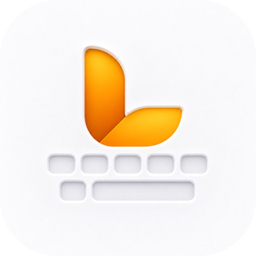
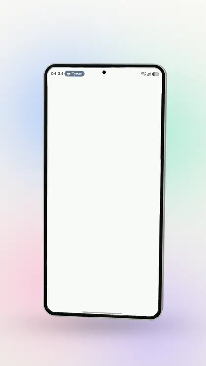
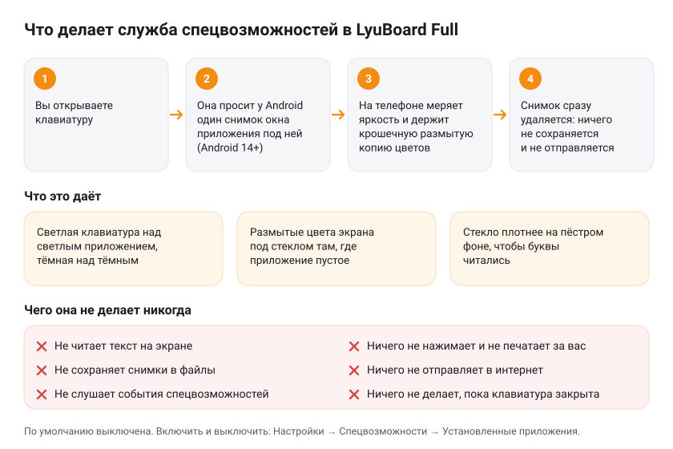

  

<h1 align="center">LyuBoard</h1>

  <b>Клавиатура для Android из стекла, механических клавиш и толковой автозамены.</b> 
  Открытая бета перед Google Play: попробуйте, сломайте, расскажите, что думаете.

  
  
  
  

  <a href="README.md">English</a> · <b>Русский</b>

   
  <a href="https://github.com/lyutobor/LyuBoard/releases/latest/download/LyuBoard-video-RU.mp4">▶ Смотреть ролик целиком в HD (MP4, 27 с)</a>

## Зачем эта страница

LyuBoard скоро выйдет в Google Play. Перед этим хочу, чтобы живые люди на своих телефонах попользовались ею
какое-то время и честно сказали, что круто, что бесит и что сломано. Это и есть бета.

**Что особенно интересно:** баги и вылеты, лаги на вашем телефоне, автозамена, которая правит не то, слова, которых
она не знает, кривой вид в ваших приложениях и чего вам не хватает по сравнению с вашей нынешней клавиатурой.
Пишите в [Issues](https://github.com/lyutobor/LyuBoard/issues/new/choose), [Discussions](https://github.com/lyutobor/LyuBoard/discussions) или в
[Telegram-канал](https://t.me/lyuBoard).

## Что внутри

- **Набор, который успевает за вами.** Свайп, автозамена, настроенная на настоящих опечатках живых людей, подсказка
  следующего слова без интернета и клавиши, которые незаметно подстраиваются под то, куда попадает *ваш* палец.
- **41 язык клавиатуры**: от русского, украинского и английского до арабского, хинди и корейского. Само приложение
  переведено на 17 языков.
- **Вид, который хочется трогать.** Матовое и морское стекло поверх любого приложения, механические клавиши с
  подсветкой, настоящие материалы (алюминий, бумага, керамика, карбон, кожа, камень), готовые темы, линии свайпа,
  звуки и вибрация под стиль.
- **✨ ИИ, когда он нужен.** Исправить, переписать вежливо или короче, ответить на скопированное сообщение или просто
  сказать голосом, что нужно. Бесплатный лимит «ИИ LyuBoard», свой ключ или модели прямо на телефоне.
- **Мелочи.** История буфера обмена, ряд эмодзи, который угадывает нужный смайл, смешивание эмодзи, гифки,
  переводчик Google без интернета (язык скачивается один раз), голосовой ввод, виджеты со статистикой набора на рабочем столе и итоги года.

## Скачать: Lite или Full?

В каждом [релизе](https://github.com/lyutobor/LyuBoard/releases/latest) лежат **два APK**. Клавиатура одна и та же, разница только в одной службе
спецвозможностей Android.

| | **LyuBoard Lite** | **LyuBoard Full** |
|---|---|---|
| Всё, что перечислено выше | ✅ | ✅ |
| Клавиатура светлая над светлым приложением, тёмная над тёмным | — | ✅ |
| Размытые цвета экрана под стеклом там, где приложение ничего не рисует | — | ✅ |
| Стекло плотнее на пёстром фоне, чтобы буквы читались | — | ✅ |
| Ставится как обычный APK | ✅ | ⚠️ Play Защита может не пустить |
| **Берите, если** | просто хотите попробовать клавиатуру | хотите, чтобы стекло выглядело на все сто (Android 14+) |

**Сомневаетесь — берите Lite.** Full потом можно поставить поверх: настройки и выученные слова останутся.

### Почему их две

Чтобы видеть, что под клавиатурой, LyuBoard Full использует разрешение Android **«Специальные возможности»**.
Play Защита считает опасным *любое* приложение не из Google Play, которое просит спецвозможности: ими часто
злоупотребляют вирусы. На многих телефонах такой APK просто не ставится, и кнопка «Всё равно установить» не помогает.
В Lite этой службы нет вообще, поэтому Android её пускает. Когда LyuBoard появится в Google Play, разделение исчезнет.

### Что именно делает служба спецвозможностей

  

По-простому: когда открывается клавиатура, LyuBoard просит у Android один снимок окна приложения под ней (без самой
клавиатуры), прямо на телефоне смотрит, светлое оно или тёмное, и держит крошечную размытую копию его цветов. Снимок
сразу выбрасывается. Технически служба спецвозможностей *может* читать экран, поэтому Android и предупреждает так
громко. LyuBoard этого не делает: не получает событий спецвозможностей, не читает текст и ничего не нажимает.
Служба **выключена, пока вы сами её не включите** после объяснения в приложении, и выключается в любой момент.

## Как установить

1. Скачайте на телефоне `LyuBoard-Lite-….apk` (или Full) из [последнего релиза](https://github.com/lyutobor/LyuBoard/releases/latest).
2. Откройте его. Если Android спросит, разрешите браузеру или файловому менеджеру ставить неизвестные приложения.
3. Откройте **LyuBoard** и пройдите приветствие: оно само включит клавиатуру и выберет её.

**Если Play Защита не пускает Full:** откройте **Play Маркет → профиль → Play Защита → ⚙ → выключите «Проверять
приложения с помощью Play Защиты»**, поставьте APK и включите проверку обратно. На Android 13+ выключатель в
спецвозможностях может быть сначала серым: **Настройки → Приложения → LyuBoard → ⋮ → Разрешить ограниченные
настройки**, потом включите. Делайте это, только если вам спокойно; Lite ничего такого не требует.

## Полезно знать

- **Это бета.** Каждая сборка перестаёт работать через **45 дней** после сборки и просит обновиться, чтобы старые
  глючные копии не жили вечно. Нажмите **Watch → Custom → Releases** вверху страницы, чтобы узнавать о новых сборках,
  или следите за [Telegram-каналом](https://t.me/lyuBoard).
- **Android 12 и новее.** Больше всего проверено на Samsung Galaxy (One UI) и OnePlus.
- **Большой файл (~375 МБ):** внутри словари всех 41 языка, поэтому набор полностью работает без интернета.
- **Обновления ставятся поверх.** Все бета-сборки подписаны одним ключом. Версия из Google Play будет подписана
  другим, поэтому, когда она выйдет, бету нужно будет один раз удалить и поставить заново.

## Приватность

- Всё, что вы набираете, остаётся на телефоне. Выученные слова, история буфера и статистика хранятся на устройстве.
- **Отчёты о сбоях** (Firebase Crashlytics) по умолчанию включены и никогда не содержат вашего текста. Выключаются в
  *О клавиатуре → Отправлять отчёты о сбоях*.
- Текст уходит в ИИ-сервис **только когда вы нажимаете ✨**, и только в тот, который вы выбрали. Бесплатный «ИИ
  LyuBoard» получает название роли и до 600 символов и не пишет текст в журналы.
- Поиск гифок идёт к KLIPY прямо с телефона.
- «Делиться анонимно» (статистика слов для улучшения словарей) — по желанию и без предложений целиком.

## Отзывы

- 🐞 [Сообщить об ошибке](https://github.com/lyutobor/LyuBoard/issues/new?template=bug.yml)
- 💡 [Предложить идею](https://github.com/lyutobor/LyuBoard/issues/new?template=idea.yml)
- 💬 [Просто рассказать, как оно](https://github.com/lyutobor/LyuBoard/discussions)
- ✈️ Telegram-канал: [t.me/lyuBoard](https://t.me/lyuBoard)

В приложении **О клавиатуре → Отправить отчёт** соберёт файл с журналом и настройками (без набранного текста),
его можно приложить к ошибке.

## Лицензия

LyuBoard — программа **с закрытым кодом**. APK отсюда можно бесплатно ставить и пользоваться ими для теста.
Копировать, изменять, декомпилировать и распространять их нельзя. Подробнее в [LICENSE](LICENSE).

© 2026 LyuBoard. Все права защищены.
